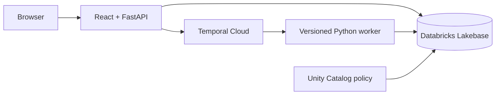

# Temporal Lakebase Agent

A personal-loan underwriting demo that combines Temporal durable execution with Databricks Lakebase operational data and Unity Catalog governance.

Temporal protects workflow progress, retries tools, and holds the human-review wait. Lakebase stores the live review state and serves governed underwriting policy at Postgres latency.

## What the demo shows

The `LoanUnderwritingWorkflow`:

1. Records a loan request and loads recent operational context.
2. Runs credit, income, debt-to-income, and policy lookups as Temporal activities.
3. Persists messages, evidence, metrics, and audit events to Lakebase.
4. Produces a recommendation and waits durably for an underwriter signal.
5. Resumes after approval, denial, or a request for more information without losing prior work.
6. Includes environment-gated resilience controls for a retryable model outage and a one-shot worker-process crash.

The default `scripted` model provider is deterministic and needs no model API key. The optional `openai` provider reads `OPENAI_API_KEY` at runtime.

## Runtime shape



The web image serves both the React application and the FastAPI API on port `8000`. The worker image polls the task queue supplied through `TEMPORAL_TASK_QUEUE`. Both images run as an unprivileged user and consume Temporal and Lakebase configuration at runtime.

## Deploy with tmprl-demo.cloud

The ready-to-review `DemoProject` resource is [deploy/tmprl-demo-cloud.yaml](deploy/tmprl-demo-cloud.yaml). The central [tmprl-demo-cloud-registry](https://github.com/temporal-sa/tmprl-demo-cloud-registry) builds both images, creates the Kubernetes and Temporal resources, injects Temporal API-key credentials, runs the `/ready` smoke check, and promotes the candidate.

The application repository does not carry Kubernetes or Helm manifests. The registry owns those resources, including the crashable demo environment. It creates an isolated task queue for each temporary environment and crashes pods through the registry operator; neither application container needs shell access or Kubernetes credentials.

### 1. Prepare Lakebase

Create or select a Lakebase Autoscaling project, initialize `sql/001_agent_ops_schema.sql`, and grant the runtime service principal access to the endpoint and schemas. The detailed setup is in [docs/databricks_lakebase_setup.md](docs/databricks_lakebase_setup.md).

The runtime uses OAuth machine-to-machine authentication, resolves the endpoint through the Databricks SDK, generates short-lived database credentials, and recycles its pool before token expiry. TLS is always required.

### 2. Create the project secret

Create the following JSON secret in the AWS account and region used by the registry:

```text
tmprl-dem-cld/lakebase-agent/lakebase
```

```json
{
  "DATABRICKS_HOST": "https://<workspace-host>",
  "DATABRICKS_CLIENT_ID": "<service-principal-client-id>",
  "DATABRICKS_CLIENT_SECRET": "<service-principal-client-secret>",
  "LAKEBASE_ENDPOINT": "projects/<project>/branches/production/endpoints/primary"
}
```

`LAKEBASE_USER` is optional; when omitted, the app uses `DATABRICKS_CLIENT_ID` as the Postgres role name.

Do not commit these values. The registry validates the required JSON properties and injects the secret only into the web and worker components.

### 3. Register the project

After this application branch is merged, copy `deploy/tmprl-demo-cloud.yaml` to:

```text
projects/demo/lakebase-agent.yaml
```

in `temporal-sa/tmprl-demo-cloud-registry`, then run its project validator and open the registry PR.

For a pre-merge candidate only, add this temporary source field to the copied resource:

```yaml
source:
  repo: https://github.com/temporal-sa/temporal-lakebase-agent
  branch: deploy/tmprl-demo-cloud-registry
```

Remove the branch override after the application change lands on `main`.

### 4. Verify the rollout

The registry gates promotion on `GET /ready`. That check opens Lakebase, verifies the operational schema is queryable, and checks Temporal service health. `GET /health` remains a process-only health endpoint.

After promotion, verify the normal experience:

1. Open `https://lakebase-agent.tmprl-demo.cloud` through the registry authentication flow.
2. Start the borderline applicant scenario.
3. Confirm all four tool activities complete and the workflow waits for review.
4. Open the Temporal link beside the run; its namespace is supplied at runtime rather than baked into the image.
5. Approve, deny, or request more information and verify the durable continuation.

To demonstrate crash recovery without executing commands inside a container:

1. From the registry catalog, create a **Crashable Environment** for this demo.
2. Open the temporary environment and start the borderline applicant scenario.
3. While the underwriting tools are running, return to the registry card and choose **Crash Workers**.
4. Reopen or refresh the temporary app after its pods restart. The workflow continues on the environment's isolated task queue and retains its completed progress in Temporal.

The hosted worker intentionally adds a short delay to each scripted underwriting tool so the crash can be triggered while work is in flight. The registry owns pod deletion and recovery; the app does not call the Kubernetes API.

The in-app **Resilience lab** is available when `DEMO_CONTROLS_ENABLED=true` on
both the web and worker components. **Start with model failure** makes the first
model activity attempt raise a retryable `ModelAPIUnavailable` error, after
which the normal Temporal retry policy continues the run. **Crash active
worker** starts a short Temporal control workflow: attempt 1 exits the worker
process, Kubernetes restarts the container, and attempt 2 confirms recovery.
The control never shells into a container and does not need Kubernetes
credentials. Use the worker control in an isolated crashable environment when
other users may share the base deployment.

## Local development

Prerequisites: Python 3.11+, Node.js 22.12+, `uv`, and a reachable Temporal server.

```bash
uv sync --extra lakebase --extra dev
cp config/example.env .env
cd web && npm install && cd ..
```

For an isolated local run, use:

```bash
LAKEBASE_CONNECTION_MODE=disabled
AGENT_MODEL_PROVIDER=scripted
TEMPORAL_ADDRESS=127.0.0.1:7233
TEMPORAL_NAMESPACE=default
TEMPORAL_TLS=false
DEMO_CONTROLS_ENABLED=false
```

Start the services in separate terminals:

```bash
temporal server start-dev
uv run python -m lakebase_agentworkflow.worker
uv run uvicorn lakebase_agentworkflow.api:app --reload --host 127.0.0.1 --port 8000
cd web && npm run dev
```

The Vite server proxies `/api` to `http://localhost:8000`. Synthetic UI data is used only when `VITE_DEMO_MODE=true`; API failures do not silently switch to sample data.

## Validation

```bash
PYTHONDONTWRITEBYTECODE=1 PYTHONPATH=src ./.venv/bin/pytest -q
cd web && npm run build
docker build -f Dockerfile.web -t lakebase-agent-web:test .
docker build -f Dockerfile.worker -t lakebase-agent-worker:test .
```

Validate `deploy/tmprl-demo-cloud.yaml` with the registry's `scripts/validate_projects.py` before submitting it there.

## Repository map

| Path | Responsibility |
| --- | --- |
| `src/lakebase_agentworkflow/workflows.py` | Deterministic Temporal workflow and human-review signals |
| `src/lakebase_agentworkflow/activities.py` | Model calls, tools, and retry-safe Lakebase persistence |
| `src/lakebase_agentworkflow/helpers/` | Temporal, Lakebase, settings, and data models |
| `src/lakebase_agentworkflow/api.py` | Web API, runtime configuration, and readiness checks |
| `web/` | React review UI and operational dashboard |
| `sql/001_agent_ops_schema.sql` | Operational schema and indexes |
| `deploy/tmprl-demo-cloud.yaml` | Registry `DemoProject` handoff |
| `scripts/` | Lakebase schema initialization and governed-policy sync |
