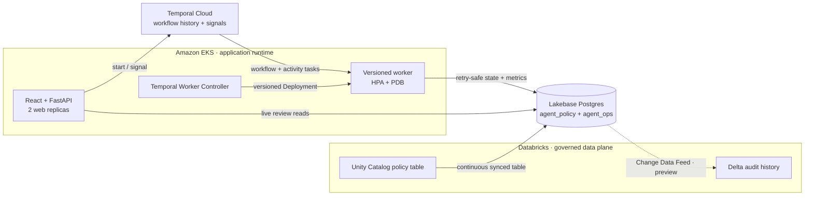

# Temporal Lakebase AgentWorkflow

A production-shaped personal-loan underwriting demo that combines **Temporal durable execution** with **Databricks Lakebase operational data** and **Unity Catalog governance**.

> **Temporal protects progress. Lakebase closes the governed data loop.**
>
> Temporal owns retries, crash recovery, versioned workers, and human waits. Lakebase serves governed policy at Postgres latency, holds the live review state, and can publish operational changes back to Unity Catalog as Delta history.

The application runtime is deliberately outside Databricks: React/FastAPI and independently scalable Temporal workers run on Amazon EKS. Databricks provides the Lakebase and Unity Catalog data plane—not the application process.

## Start Here

| Guide | Use it for |
| --- | --- |
| [Visual architecture](docs/architecture.html) | System boundaries, data paths, security, scaling, and failure recovery |
| [What was built and why](docs/implementation.html) | Verified infrastructure, deployment decisions, evidence, and remaining work |
| [End-to-end demo runbook](docs/demo_runbook.html) | Exact commands, SQL, expected results, presenter narration, and troubleshooting |
| [Current setup status](docs/setup_status.md) | Live resource names, image digests, identity grants, and smoke-test evidence |
| [Why Temporal and Lakebase](docs/why_temporal_and_lakebase.md) | Source-backed Temporal and Lakebase positioning, including Neon and other alternatives |

The HTML guides are standalone, responsive, and print-friendly. Open them directly in a browser, or serve the repository locally with `python3 -m http.server` and visit `/docs/architecture.html`.

## Architecture at a Glance



The two proof points are independent:

- **Why Temporal:** kill a worker after completed activities; the replacement continues from durable history without rebuilding control state from database flags or repeating finished calls.
- **Why Lakebase:** serve Unity Catalog policy into Postgres through a managed synced table, then send the reviewed operational decision back to Delta through Lakebase Change Data Feed.

Neon, Aurora, and Supabase are capable Postgres backends. The Lakebase advantage demonstrated here is narrower: when Databricks already governs the inputs and consumes the resulting history, the inbound serving path and outbound change path are managed in the same platform.

## Current Deployed Environment

| Component | Current state |
| --- | --- |
| EKS | Cluster `ferocious-electro-pumpkin`, namespace `tf-demo-zsvab` |
| Helm | Release `lakebase-agentworkflow`, revision `4` |
| Web/API | Two non-root replicas behind private `ClusterIP` service `lakebase-agentworkflow-web` |
| Worker | Temporal Worker Controller `WorkerDeployment/lakebase-agentworkflow-worker` |
| Scaling | Per-version HPA: 1–10 replicas at 70% CPU; per-version PDB: 1 available |
| Images | Immutable tag `20260712-a91e17b3d04a` in dedicated ECR repositories |
| Temporal | Cloud namespace `tf-demo.zsvab`, task queue `lakebase-agent-task-queue` |
| Lakebase | Project `temporal-lakebase-agentworkflow`, branch `production`, database `databricks_postgres` |
| Policy | Continuous sync into `agent_policy.underwriting_policy_limits` |
| Smoke run | Run `37396a21-c6bd-4a0c-8a3a-96ce063609a8`, intentionally left at `awaiting_review` |

See [setup_status.md](docs/setup_status.md) for exact service-principal IDs, digests, permissions, and verification output.

## Five-Minute Deployed Demo

The web service is private by design. Start a loopback-only connection:

```bash
AWS_PROFILE=SolutionsArchitecture/AWSAdministratorAccess \
AWS_REGION=us-west-2 \
AWS_DEFAULT_REGION=us-west-2 \
kubectl port-forward \
  service/lakebase-agentworkflow-web \
  18001:80 \
  --address 127.0.0.1 \
  --namespace tf-demo-zsvab
```

Then open [http://127.0.0.1:18001](http://127.0.0.1:18001):

1. Select the `eks-smoke@temporal.io` run.
2. Confirm the run is waiting for review and shows all four underwriting tools.
3. Confirm the policy proof reads **Unity Catalog → Lakebase synced table** and `lakebase_synced_table`.
4. Enter a reviewer and rationale, then approve, deny, or request more information.
5. Query `agent_ops.agent_review_decisions` in the Lakebase SQL Editor to show the persisted decision.

Use the [full demo runbook](docs/demo_runbook.html) for the Lakebase SQL, Temporal checks, crash-recovery option, Change Data Feed setup, expected outputs, and presenter script.

## What the Demo Does

The `LoanUnderwritingWorkflow`:

1. Records the loan request and loads recent operational context.
2. Calls a model activity to choose the next action.
3. Runs credit, income, debt-to-income, and policy lookups as separate Temporal activities.
4. Persists messages, tool evidence, audit events, and operational metrics to Lakebase.
5. Produces a recommendation and waits durably for an underwriter signal.
6. Completes, denies, or resumes for more information without losing the prior trail.

The default `scripted` provider is deterministic and requires no external model API. Set `AGENT_MODEL_PROVIDER=openai` and provide `OPENAI_API_KEY` to exercise the model-backed activity.

## Repository Map

| Path | Responsibility |
| --- | --- |
| `src/lakebase_agentworkflow/workflows.py` | Deterministic Temporal workflow, signals, queries, and review gate |
| `src/lakebase_agentworkflow/activities.py` | Model calls, tools, and retry-safe Lakebase persistence |
| `src/lakebase_agentworkflow/helpers/` | Environment, Temporal client, data models, OAuth, pooling, and Postgres repository |
| `src/lakebase_agentworkflow/api.py` | FastAPI workflow, review, run, transcript, and metrics endpoints |
| `web/` | React review UI and operational dashboard |
| `sql/001_agent_ops_schema.sql` | Lakebase UI, audit, review, and metric schema with CDF replica identity |
| `deploy/helm/temporal-lakebase-agentworkflow/` | Web Deployment/Service, Temporal Connection, WorkerDeployment, HPA, and PDB |
| `Dockerfile.web` / `Dockerfile.worker` | Separate non-root web and worker images |
| `scripts/demo_crash_recovery.sh` | Rehearsed hard-kill and recovery demonstration |
| `scripts/setup_underwriting_policy_sync.sh` | Governed Unity Catalog policy and continuous Lakebase sync |
| `spec/` | Requirements, traceability, issues, and best-practice review artifacts |
| `docs/` | Architecture, deployment evidence, setup guides, competitive story, and runbooks |

## Local Development

### Prerequisites

- Python 3.11+
- Node.js 22+
- `uv`
- Temporal CLI or another reachable Temporal Server
- Databricks CLI 0.294+ only when connecting to Lakebase

Install dependencies and create local configuration:

```bash
uv sync --extra lakebase --extra dev
cp config/example.env .env
cd web && npm install && cd ..
```

For an isolated local run, set these values in `.env`:

```bash
LAKEBASE_CONNECTION_MODE=disabled
AGENT_MODEL_PROVIDER=scripted
TEMPORAL_ADDRESS=127.0.0.1:7233
TEMPORAL_NAMESPACE=default
TEMPORAL_TLS=false
```

Start the services in separate terminals:

```bash
temporal server start-dev
```

```bash
uv run python -m lakebase_agentworkflow.worker
```

```bash
uv run uvicorn lakebase_agentworkflow.api:app \
  --reload --host 127.0.0.1 --port 8000
```

```bash
cd web && npm run dev
```

Start a workflow:

```bash
uv run python -m lakebase_agentworkflow.starter \
  "Underwrite this personal loan" \
  --applicant-id applicant-borderline \
  --loan-amount 25000 \
  --loan-purpose debt_consolidation \
  --max-turns 6
```

The Vite server proxies `/api` to `http://localhost:8000`. Synthetic UI data is enabled only with `VITE_DEMO_MODE=true`; API failures never silently switch to demo data unless `VITE_ALLOW_DEMO_FALLBACK=true` is also set.

## Validation

```bash
PYTHONDONTWRITEBYTECODE=1 PYTHONPATH=src ./.venv/bin/pytest -q
```

```bash
cd web && npm run build
```

```bash
helm lint deploy/helm/temporal-lakebase-agentworkflow
helm template lakebase-agentworkflow \
  deploy/helm/temporal-lakebase-agentworkflow \
  --namespace tf-demo-zsvab \
  --values deploy/helm/temporal-lakebase-agentworkflow/values.eks.yaml
```

The current validated baseline is 19 Python tests, a production React build, Helm lint/render, server-side Kubernetes validation, and amd64 container builds.

## EKS Deployment

The chart references an existing Kubernetes Secret and never stores secret values. Endpoint mode requires these keys in `temporal-lakebase-agentworkflow-secrets`:

- `temporal-api-key`
- `databricks-client-id`
- `databricks-client-secret`
- `openai-api-key` only when the provider is `openai`

Deploy the immutable ECR coordinates in `values.eks.yaml`:

```bash
helm upgrade --install lakebase-agentworkflow \
  deploy/helm/temporal-lakebase-agentworkflow \
  --namespace tf-demo-zsvab \
  --values deploy/helm/temporal-lakebase-agentworkflow/values.eks.yaml \
  --rollback-on-failure \
  --wait \
  --timeout 15m
```

The Worker Controller injects `TEMPORAL_ADDRESS`, `TEMPORAL_NAMESPACE`, `TEMPORAL_DEPLOYMENT_NAME`, and `TEMPORAL_WORKER_BUILD_ID`. The Python worker uses the deployment/build pair to enable pinned Worker Deployment Versioning. Do not set those four values in the worker pod template.

## Lakebase and Unity Catalog Data

Governed input flows into Lakebase:

```text
agentworkflow_lakehouse.governed.underwriting_policy_limits
    → continuous managed sync
agent_policy.underwriting_policy_limits
```

The worker writes operational state into:

- `agent_runs`, `agent_messages`, and `agent_tool_calls` for the live UI.
- `agent_review_decisions` for retry-safe human-review records.
- `agent_events` for audit events.
- `agent_workflow_metrics`, `agent_turn_metrics`, and `agent_activity_attempt_metrics` for diagnostics.
- `agent_activity_retry_counts` for explicit retry summaries.

When the Public Preview Change Data Feed is enabled, operational state flows back to Unity Catalog:

```text
agent_ops.agent_review_decisions
    → Lakebase Change Data Feed
agentworkflow_lakehouse.agent_ops.lb_agent_review_decisions_history
```

Do not write directly to `agent_policy.underwriting_policy_limits`; it is owned by the managed sync pipeline.

## Authentication and Least Privilege

- Human setup uses the explicitly selected Databricks CLI profile `dbc-33a81e40`.
- EKS uses OAuth machine-to-machine credentials for service principal `lakebase-agentworkflow-eks`.
- The runtime identity has Lakebase project `CAN_USE`, not `CAN_MANAGE`.
- Its matching Postgres role can connect, read governed policy, and `SELECT`/`INSERT`/`UPDATE` the required operational tables; it has no `DELETE`, schema-management, database-creation, role-creation, or superuser privilege.
- Credentials live in Kubernetes Secrets, never in images, ConfigMaps, Helm values, or source control.
- All Lakebase connections require TLS and use short-lived credentials with pool recycling.

See [production_setup.md](docs/production_setup.md) for the reproducible permission contract and [setup_status.md](docs/setup_status.md) for the current identity and resource evidence.

## Crash-Recovery Variant

For the local hard-kill demonstration:

```bash
scripts/demo_crash_recovery.sh
```

The script waits for credit and income activities, sends `SIGKILL` to the worker, pauses for narration, starts a replacement worker, and verifies that the same workflow continues to the human-review gate. Ensure no other worker is polling the same task queue before using this variant.

Useful controls include `DEMO_AUTO_CONTINUE=1`, `DEMO_START_TEMPORAL_SERVER=always`, `DEMO_TOOL_DELAY_SECONDS=3`, `DEMO_KEEP_WORKER_RUNNING=0`, and `DEMO_LOG_DIR=/path`.

## Remaining Deliberate Steps

- **Lakebase Change Data Feed:** schema and destination storage are ready, but the workspace preview/UI feed still needs to be enabled and verified.
- **External access:** the deployed web service is `ClusterIP`. Add an authenticated ingress only after a separate security review.
- **Production hardening:** use separate web and worker service principals, external secret rotation, workload-specific network policies, alerting, and capacity tests before treating the demo as a production service.

## Additional References

- [Databricks and Lakebase setup](docs/databricks_lakebase_setup.md)
- [Production setup and permissions](docs/production_setup.md)
- [Demo level-up plan](docs/demo_levelup_plan.md)
- [Helm chart runbook](deploy/helm/temporal-lakebase-agentworkflow/README.md)
- [Spec narrative](spec/spec.md)
